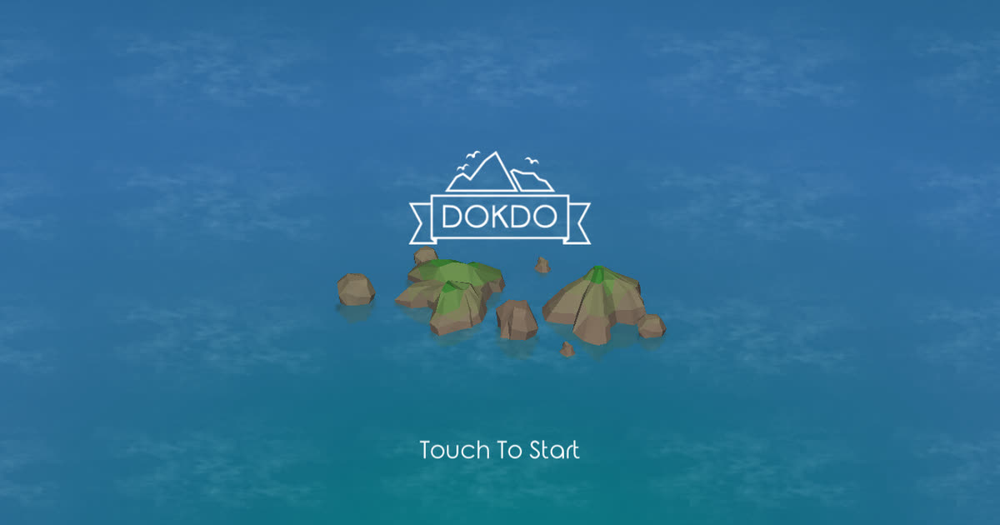
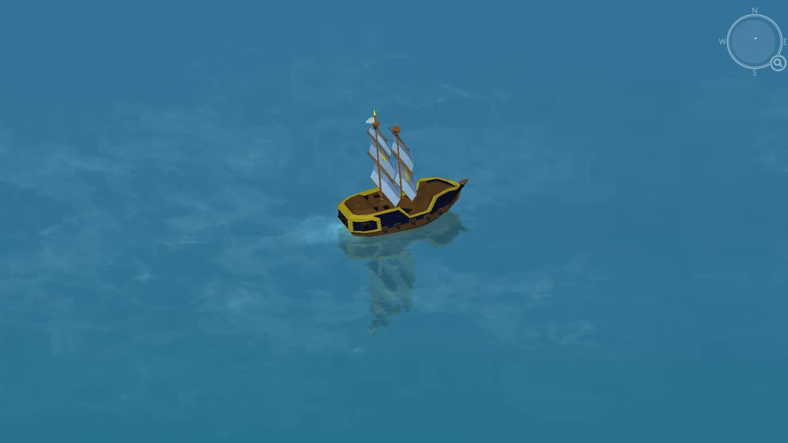
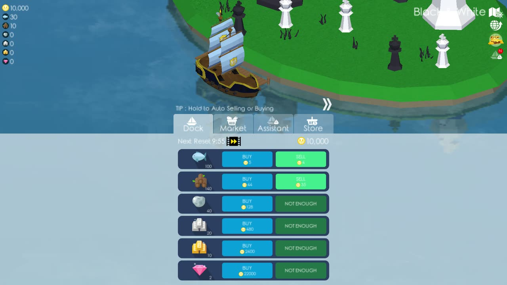
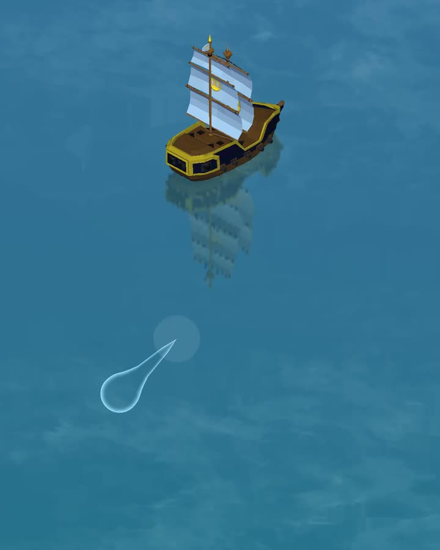
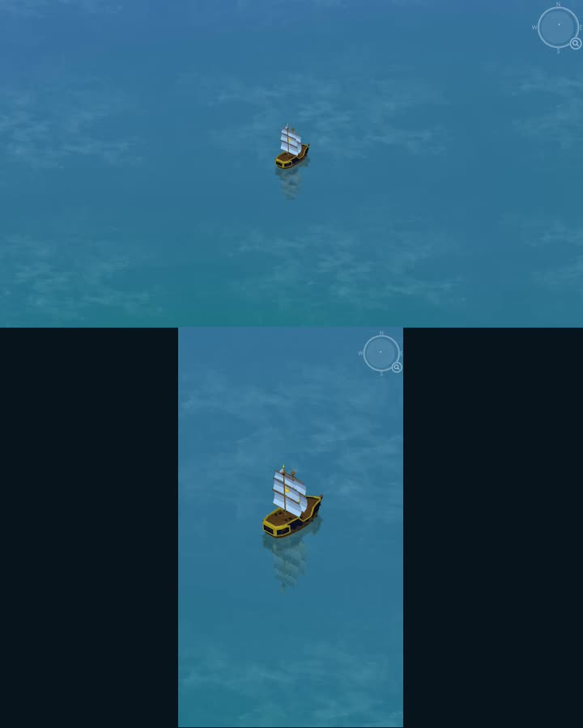
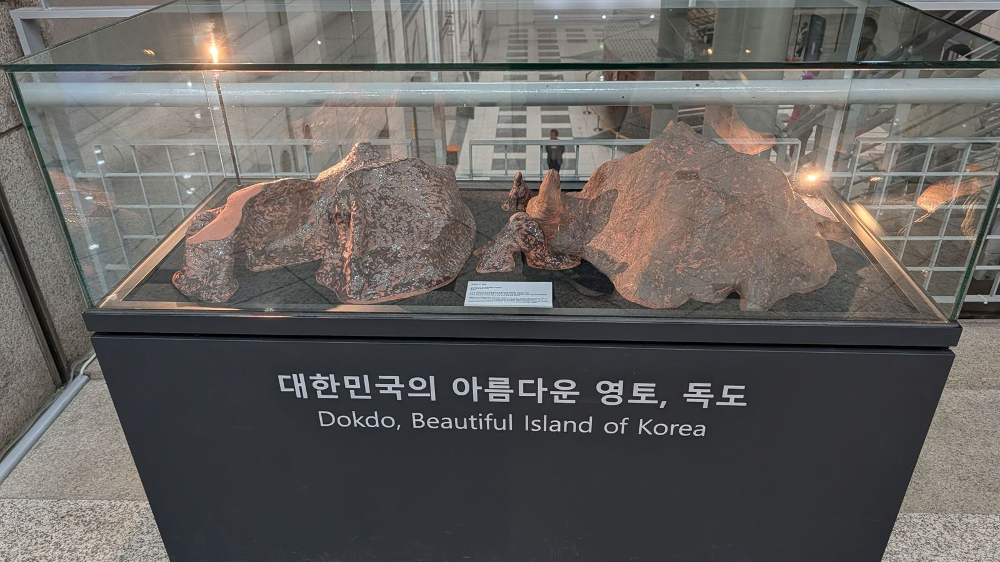

# DOKDO standalone source, WebGL and Android builds

This repository now includes **source-available standalone Unity source**
derived from `dokdo-1.16.6-web9-r6`. Build instructions, provenance and the
publication workflow are in [docs/publication](docs/publication/README.md).
The standalone player keeps gameplay, local saves and clipboard transfer.
It has no chat, emotes, shared sea, online counts or shared treasure events.
See the [releases](https://github.com/ykondrashyn/dokdo.online/releases) for
available artifacts; an unqualified local candidate is not a published release.

The hosted online game remains at [dokdo.online](https://dokdo.online/).
The player guide below describes that hosted version. Social features and
public captain names are **hosted-only**; ordinary gameplay and save controls
also apply to the standalone game. Its source has no blanket open-source
license over recovered material; see [provenance](docs/publication/PROVENANCE.md).

The existing Android APK is a separate historical artifact. The Android
build below creates a new standalone app; it does not reproduce that APK.

## Build the standalone game

For an Android APK, see [Build an Android APK](#build-an-android-apk) below.
This section builds the browser version; Mobile/ASTC is also WebGL.

The repository includes the Unity project, gameplay code, scenes, assets,
and build tools. You do not need the original APK or the private source
repository to build it.

Install and activate **Unity 6000.3.18f1** with **Web Build Support**, plus
**Python 3.10 or newer**, **Git**, and **ffmpeg** on your PATH. The commands
below use Bash and have been validated on Linux. Use editor and project paths
without spaces, commas, or double quotes.

```bash
git clone --branch standalone-publication \
  https://github.com/ykondrashyn/dokdo.online.git
cd dokdo.online

# Set this to your installed Unity editor executable.
export UNITY_EDITOR=/path/to/6000.3.18f1/Editor/Unity
python3 tool/publication.py build
python3 -m http.server 8000 --directory Builds/Standalone
```

Run the build from a clean, committed checkout. It compiles the project,
runs the EditMode and PlayMode tests, and builds both **Desktop/DXT** and
**Mobile/ASTC** WebGL players into `Builds/Standalone/`.

Open **http://localhost:8000/** to play. The page selects a compatible player
for your browser. Serve the files over HTTP; opening `index.html` directly
from disk does not work.

To create a ZIP after the build, run this in another terminal from the
repository directory:

```bash
python3 tool/publication.py candidate
```

The ZIP, `publication.json`, and `SHA256SUMS` are written to `Builds/Review/`.
This is a local review candidate; release qualification requires the
[browser acceptance checklist](docs/publication/ACCEPTANCE.md).
See the [full build and verification guide](docs/publication/README.md) for
individual checks, browser tests, and release packaging.

## Build an Android APK

Install and activate **Unity 6000.3.18f1** with **Android Build Support**,
**Android SDK & NDK Tools**, and **OpenJDK** in Unity Hub. Use the bundled
tools and install Android SDK Platform **36** if it is missing. The command
below also requires **Python 3.10+**, **Git**, and **Bash**. Close the Unity
Editor before running it from a clean, committed checkout:

```bash
git clone --branch standalone-publication \
  https://github.com/ykondrashyn/dokdo.online.git
cd dokdo.online
export UNITY_EDITOR=/path/to/6000.3.18f1/Editor/Unity
python3 tool/publication.py build-android
```

Output: **`Builds/Android/dokdo-standalone.apk`**, `build.json`, and
`SHA256SUMS`. This produces an **ARM64** APK for **Android 7.1/API 25 or
newer**, using IL2CPP, OpenGL ES 3 and ETC2 textures. It runs the EditMode
and PlayMode suites in the Editor with Android selected; those tests do not
replace testing on a phone.

The APK uses your machine's **debug signing key** and the separate package
ID `com.reconstruction.dokdo.standalone`. It can coexist with the historical
APK. No original APK, private repository, server, or private signing key is
needed. Move `Builds/Android` aside before another build.

With USB debugging enabled and the Android SDK's `adb` on your PATH:

```bash
adb install -r Builds/Android/dokdo-standalone.apk
```

The [Android build guide](docs/publication/ANDROID.md) also covers building
through Unity's menus, release signing, installation problems, save transfer,
and the device checks still required before distributing an APK.

---

<div align="center">

# ⚓ DOKDO Online: Play DOKDO Free in Your Browser

### [▶️ **PLAY NOW AT DOKDO.ONLINE**](https://dokdo.online/?ref=github)

**Sail between islands, battle pirates, fish, trade, upgrade your ship and face the Kraken. Free on phone and desktop. No download, no APK, no account.**

[](https://dokdo.online/?ref=github)
[](https://discord.gg/Fx9uaS5Mgd)
[](https://github.com/ykondrashyn/dokdo.online/releases/tag/v1.16.6-r1)

[](https://dokdo.online/?ref=github)

*Unofficial browser restoration of Zzoo's 2017 mobile sailing game DOKDO (독도까지 · 배 키우기). Not affiliated with or endorsed by Zzoo.*

</div>

---

## 📑 Contents

- [Build the standalone game](#build-the-standalone-game)
- [Build an Android APK](#build-an-android-apk)
- [What is DOKDO?](#-what-is-dokdo)
- [Features](#-features)
- [Screenshots](#-screenshots)
- [How to play and controls](#-how-to-play-and-controls)
- [Your first trip](#-your-first-trip)
- [Gameplay guide](#-gameplay-guide)
- [Devices and browser requirements](#-devices-and-browser-requirements)
- [Saves: backup and transfer](#-saves-backup-and-transfer)
- [Android APK](#-android-apk)
- [FAQ](#-faq)
- [한국어 안내](#-한국어-안내)
- [History of the real Dokdo island](#-history-of-the-real-dokdo-island)
- [Community](#-community)
- [Disclaimer](#%EF%B8%8F-disclaimer)

---

## 🌊 What is DOKDO?

**DOKDO** is a sailing action game first released for mobile by **Zzoo** in 2017, known in Korean as **독도까지 (배 키우기)**. You start with a small boat, cross open water, capture islands from pirate fleets and build your ship up one capture at a time.

The original app is hard to find today, so **[dokdo.online](https://dokdo.online/?ref=github)** brings DOKDO back as a free browser game you can play online in any modern phone or desktop browser. It keeps the original sailing, fishing, markets, upgrades and island battles, and adds a **shared sea** where you can see other captains.

> This is an **unofficial** reconstruction. It is not affiliated with, endorsed by, or connected to Zzoo.

**[▶️ Play DOKDO online now](https://dokdo.online/?ref=github)**

---

## ✨ Features

This table describes the hosted online game. Shared sea, chat and emotes are hosted-only.

| | Feature | Details |
|---|---|---|
| ⛵ | **Sailing** | Press and drag to steer across open water. Double-tap to keep sailing. |
| 🏝️ | **Island battles** | Approach an island, defeat its defending fleet and claim the capture reward. |
| 🎣 | **Fishing** | Fish near captured islands when no enemy is close. Upgrades raise your catch. |
| 💰 | **Trading** | Buy goods with coins and sell cargo at island markets. |
| 🔧 | **Ship upgrades** | Upgrade body, sail, steering, cannon and fishing. |
| 🚤 | **Assistants** | Assistant ships fight beside you. Seagulls heal on long trips, Nessy raises max health. |
| 🌍 | **Two worlds** | Explore two oceans, each with its own arena record. |
| ⚔️ | **Arena** | Wave fights against pirates, with rewards based on how many you defeat. |
| 🐙 | **The Kraken** | Build your fleet and face the Kraken. |
| 🧭 | **Shared sea** | See nearby captains from other browsers. *(New in the browser version.)* |
| 💬 | **Chat** | Send short messages to nearby captains. *(New in the browser version.)* |
| 😄 | **Emotes** | Ship emotes for saying hi without typing. *(New in the browser version.)* |
| 📱 | **Phone and desktop** | Runs in the browser. No install, no account, free. |

The shared sea, chat and emotes belong to the reconstruction and were not part of the original 2017 game. Other players **cannot** affect your combat, island captures or progress. Each captain plays their own game.

---

## 🖼️ Screenshots

| Sailing | Island menu |
|---|---|
|  |  |
| **Controls** | **Play modes** |
|  |  |

*Images from [dokdo.online](https://dokdo.online/?ref=github).*

---

## 🎮 How to play and controls

| Action | Desktop | Phone / tablet |
|---|---|---|
| Steer | Press and drag over the water with the mouse | Press and drag with a finger |
| Keep sailing | Double-click a direction (within half a second) | Double-tap a direction |
| Slow down | Release | Lift your finger |
| Zoom | Mouse wheel | Two-finger pinch |
| Return to manual control | Press and drag again | Press and drag again |

Zoom is paused while your ship is docked.

---

## 🧭 Your first trip

1. Open **[dokdo.online](https://dokdo.online/?ref=github)**, press **Play** and enter the captain name other players will see.
2. Press and drag over the water to steer. Double-click or double-tap a direction to keep sailing after you release.
3. Approach the marked island, defeat its defenders and collect the capture reward.
4. Dock at an island you control to repair, trade, upgrade and prepare for the next crossing.

---

## 📖 Gameplay guide

### ⚔️ Combat
Sail close enough for an enemy to enter cannon range. Your **side cannons** track targets in their firing arc and fire after reloading, so turn the matching side of your ship toward the target and keep clear of incoming shots. Destroyed enemies can drop resources. If your ship sinks, the revive screen opens.

### 🏝️ Island capture
Uncaptured islands call in a defending fleet when you approach. Defeat every defender to take the island. A captured island becomes a safe place to dock.

### 🎣 Fishing
Move near a captured island while still at sea. The fishing control appears when no enemy is close.

### 💰 Markets
Dock at a captured island and open its market to buy goods with coins or sell your cargo. Stock changes as you trade and comes back when the market resets.

### 🔧 Ship upgrades
Spend coins and resources on the **body, sail, steering, cannon and fishing** tracks. Body level caps the other tracks, so raise it when another part hits its maximum.

### 🚤 Assistants
Buy assistants from the island menu. Assistant ships follow you and fire at nearby enemies, getting stronger with their own level. **Seagulls** restore some health during long trips, and **Nessy** increases maximum health.

### 🏟️ Arenas
Sail through an arena entrance to start a separate wave fight. Each cleared wave brings another group of pirates, and your reward depends on how many you defeat. The second ocean has its own arena record.

Full guide: **[dokdo.online/guide](https://dokdo.online/guide/?ref=github)**

---

## 💻 Devices and browser requirements

- **Works on:** phones, tablets and desktop PCs/Macs using a current browser (Chrome, Edge, Firefox, Safari).
- **Requires:** JavaScript and **WebGL 2**.
- The site checks your browser before choosing a compatible game build. If **Play** stays disabled or the game doesn't load, see the browser help at [dokdo.online](https://dokdo.online/?ref=github). It covers browser checks, loading errors, portrait mode and refreshing cached files without clearing your save.

---

## 💾 Saves: backup and transfer

- Progress is saved in your browser's **local storage** under the exact site address.
- It does **not** follow you to another browser, device or web address on its own.
- **Clearing site data deletes your save.** Private browsing and storage restrictions may also stop it from surviving after the tab closes.

**Back up:** open **Copy Save** in the game and keep the copied text somewhere safe.
**Restore or move:** use **Paste Save** to restore that backup, or to move the **same save between the browser and Android versions**.

---

## 🤖 Android APK

Historical `v1.16.6-r1` artifact, separate from the standalone WebGL build.

Prefer an app? The Android build is attached to the release:

**[⬇️ Download dokdo-1.16.6-r1.apk (v1.16.6-r1)](https://github.com/ykondrashyn/dokdo.online/releases/download/v1.16.6-r1/dokdo-1.16.6-r1.apk)** · [Release page](https://github.com/ykondrashyn/dokdo.online/releases/tag/v1.16.6-r1) · also in this repo as [`dokdo-1.16.6-r1.apk`](dokdo-1.16.6-r1.apk)

- File size: 39,247,661 bytes (~37.4 MB)
- Install by allowing "Install unknown apps" for your browser or file manager when Android asks.
- **Moving progress:** Copy Save on one version, Paste Save on the other. The browser and Android versions share the save format.
- Don't want to sideload? Just **[play in your browser](https://dokdo.online/?ref=github)**. Nothing to install, and you can skip risky APK mirror sites.

---

## ❓ FAQ

**Is this the original DOKDO?**
It's an unofficial browser reconstruction of Zzoo's 2017 game. It keeps the original sailing, fishing, upgrades and island battles, with a shared sea added for browser players.

**Is DOKDO free?**
Yes, the browser version is free to play.

**Do I need an account?**
No. You pick a public captain name for the shared sea, with no sign-up.

**Can I play on PC?**
Yes, in a current desktop browser.

**Can I play on my phone without an APK?**
Yes. Open [dokdo.online](https://dokdo.online/?ref=github) in your phone's browser. You can also add it to your home screen.

**What can I do with other players?**
See nearby captains, send short messages and use ship emotes. Others can't affect your combat, captures or progress.

**Where is my progress saved?**
In local storage for the site. Use Copy Save to keep a backup.

**Play stays disabled. What now?**
Your browser may lack WebGL 2. Update it or try another browser, and see the browser help on the site.

**Where can I report bugs or give feedback?**
On our [Discord](https://discord.gg/Fx9uaS5Mgd).

---

## 🇰🇷 한국어 안내

**독도까지 (배 키우기)**를 기억하시나요? Zzoo가 2017년에 출시한 항해 액션 게임 DOKDO를 이제 브라우저에서 **무료**로 플레이할 수 있습니다.

- **[dokdo.online](https://dokdo.online/?ref=github)**: 다운로드, APK, 계정 필요 없음
- 휴대폰과 PC 브라우저 모두 지원 (WebGL 2 필요)
- 항해, 섬 점령, 해적 전투, 낚시, 무역, 배 업그레이드, 아레나, 크라켄
- 공유 바다에서 근처 선장들과 메시지와 이모트 교환
- 진행 상황은 브라우저에 저장됩니다. **Copy Save**로 백업하고 **Paste Save**로 복원하거나 안드로이드 버전과 옮길 수 있습니다.

Zzoo와 관련이 없는 비공식 팬 복원 프로젝트입니다.

**[▶️ 지금 플레이하기](https://dokdo.online/?ref=github)** · [디스코드](https://discord.gg/Fx9uaS5Mgd)

---

## 🌅 History of the real Dokdo island

The game takes its name from **Dokdo (독도, 獨島, "solitary island")**, Korea's easternmost territory in the East Sea. The gameplay demo even opens with a reconstruction of the islets before the voyage begins.

<p align="center">
  
  <br>
  <em>A model of Dokdo displayed at the War Memorial of Korea in Seoul, with the sign "대한민국의 아름다운 영토, 독도 — Dokdo, Beautiful Island of Korea". Photo by the repo author.</em>
</p>

### 🧭 Geography

Dokdo belongs to **Dokdo-ri, Ulleung-eup, Ulleung County, Gyeongsangbuk-do** (North Gyeongsang Province). It is made up of two main islands, **Dongdo** (East Islet) and **Seodo** (West Islet), about 151 m apart, plus **89 smaller islets and rocks**. The total area is about 187,554 m², and the highest point is 168.5 m on Seodo. The islets are volcanic, formed roughly 4.5 million years ago. Dokdo lies 87.4 km from Ulleungdo, the nearest Korean island, and on a clear day it can be seen from there with the naked eye. It is a protected Natural Monument (No. 336, 1982) and a breeding ground for seabirds such as black-tailed gulls and storm petrels.

### 📜 Timeline

| Year | Event |
| --- | --- |
| **512** | General **Isabu** of the Silla kingdom subjugates **Usan-guk**, the island state of Ulleungdo and Dokdo. The *Samguk Sagi* (1145) records the conquest, and Korea dates its sovereignty over Dokdo from it. |
| **1454** | The ***Sejong Sillok Jiriji***, the geography section of the Annals of King Sejong, places Usan (Dokdo) and Mureung (Ulleungdo) under Uljin County and notes that the two islands "are not far apart… [and] can be seen from each other on a clear day." |
| **1693–1696** | The fisherman **An Yong-bok** is abducted by Japanese fishermen on Ulleungdo in 1693, sparking the "Ulleungdo Dispute" between Joseon and Japan. On his 1696 trip to Japan he told officials that Ulleungdo and Dokdo (Jasando) belonged to Korea. In January 1696 the Tokugawa shogunate banned Japanese voyages to Ulleungdo. |
| **1770** | The *Dongguk Munheon Bigo* records that "Ulleung and Usan are both territories of Usan-guk, and Usan is what Japan calls Matsushima." |
| **1900** | On October 25, Emperor Gojong approves **Imperial Ordinance (Decree) No. 41** of the Korean Empire, published on October 27. It renames Ulleungdo as Uldo County and puts "all of Ulleungdo, Jukdo and **Seokdo [Dokdo]**" under its jurisdiction. |
| **1905** | During the Russo-Japanese War, Japan incorporates the islets into Shimane Prefecture through **Shimane Prefecture Public Notice No. 40**. Korea sees this as the first step in Japan's takeover of Korea, which ended in annexation in 1910. |
| **1946** | After Japan's defeat in World War II, the Allied occupation's **SCAPIN 677** separates Dokdo from Japanese administration, and SCAPIN 1033 bars Japanese ships from coming within 12 nautical miles of it. |
| **1953–1956** | Ulleungdo residents led by Korean War veteran **Hong Sun-chil** form the **Dokdo Volunteer Garrison** and drive off Japanese patrol boats. From August 1954 police are stationed on Dongdo alongside a guard post and lighthouse. In 1956 the volunteers hand the guard duty over to the police. |
| **1954–today** | Korea has administered Dokdo continuously since then. The **Dokdo Security Police** live on the islets, the **Korea Coast Guard** patrols the waters, and lighthouse keepers and Ulleung County officials also live there. Tourists can visit by ferry from Ulleungdo when the weather allows. |
| **2000 / 2010** | Civic groups proclaim **October 25** as **Dokdo Day (독도의 날)** in 2000, marking the 1900 ordinance. Ulleung County made it official in 2010. |

### 🇰🇷 Dokdo in Korea today

For Koreans, Dokdo is more than two rocks at sea. It stands for sovereignty restored after Japanese colonial rule. The Korean government's position is that Dokdo is "an integral part of Korean territory, historically, geographically and under international law," and that no territorial dispute exists. Dokdo shows up in school lessons, museums like the War Memorial of Korea and the Dokdo Museum on Ulleungdo, songs ("독도는 우리 땅", *Dokdo Is Our Land*), and nationwide events every year on Dokdo Day, **October 25**.

> **Note:** Japan claims the islets under the name **Takeshima**. They are also called the Liancourt Rocks, after a French whaling ship that nearly wrecked there in 1849.

### 🎬 Watch: the story in ten minutes

[](https://youtu.be/2oLwsrIJdJQ)

▶️ [**The strangest Island Dispute you've probably never heard about**](https://youtu.be/2oLwsrIJdJQ) by Politics with Paint

### 📚 Sources

- [Dokdo, Beautiful Island of Korea](https://dokdo.mofa.go.kr/eng/), Ministry of Foreign Affairs, Republic of Korea
- [Q&A on Dokdo](https://dokdo.mofa.go.kr/eng/dokdo/faq.jsp) (Sejong Sillok Jiriji, An Yong-bok, Imperial Decree No. 41), MOFA
- [Dokdo history timeline](https://dokdo.mofa.go.kr/m/eng/dokdo/reason_list.jsp) (512 to SCAPIN 677/1033), MOFA
- [*Samguk Sagi* entry on Isabu and Usan-guk](https://db.history.go.kr/id/sg_044r_0050_0030), National Institute of Korean History database
- [Dokdo: The Start of the Korean Peninsula](https://www.korea.net/FILE/pdfdata/2016/02/StartoftheKoreanPeninsulaDokdo_en_20160216.pdf) (Dokdo Volunteer Guard, police and coast guard), Korea.net / Gyeongsangbuk-do
- [독도의용수비대 (Dokdo Volunteer Garrison)](https://encykorea.aks.ac.kr/Contents/Item/E0073512), Encyclopedia of Korean Culture, Academy of Korean Studies
- [Why is Dokdo Day October 25?](https://www.korea.kr/news/policyNewsView.do?newsId=148879058) (in Korean), Korea.kr policy briefing
- [Liancourt Rocks](https://en.wikipedia.org/wiki/Liancourt_Rocks) (geography figures), Wikipedia

---

## 💬 Community

Join other captains, share your fleet, report bugs and get news first:

**[👉 Join the DOKDO Discord](https://discord.gg/Fx9uaS5Mgd)**

If you enjoy the game, ⭐ star this repo and share **[dokdo.online](https://dokdo.online/?ref=github)** with friends who remember DOKDO.

---

## ⚖️ Disclaimer

DOKDO Online is an **unofficial, non-commercial fan restoration** made for game preservation. The original DOKDO game, its name, artwork and related assets belong to their respective owners, including **Zzoo**. This project is **not affiliated with, endorsed by, or sponsored by Zzoo** or any rights holder.

**Takedown on request:** if you are a rights holder and want any content here removed, please open an issue in this repository or contact us on [Discord](https://discord.gg/Fx9uaS5Mgd), and it will be taken down promptly.

---

<div align="center">

**Keywords:** DOKDO game, play DOKDO online, DOKDO browser game, DOKDO Zzoo, 독도까지, 배 키우기, free sailing game, pirate ship game, island capture game, HTML5 / WebGL game, DOKDO APK, retro mobile game preservation

### [⚓ Set sail at dokdo.online](https://dokdo.online/?ref=github)

</div>
